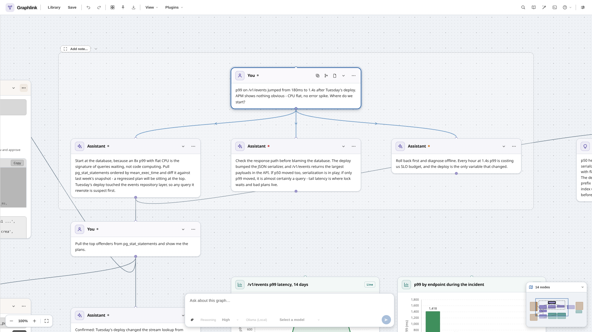
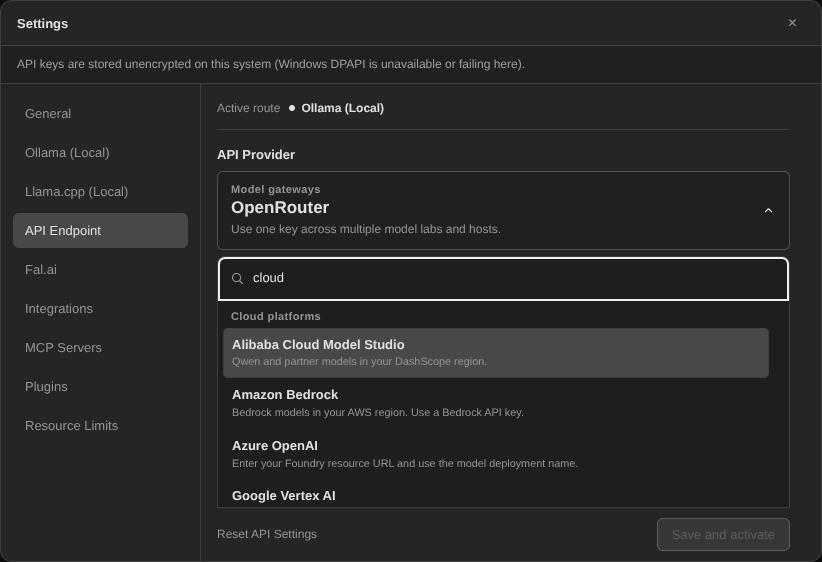

#  Graphlink

**A local-first desktop workspace for branching AI conversations.** Ask a question, fork a reply into two lines of inquiry, then bring their answers together. Each branch keeps its own conversation history. Notes, sources, code, charts, and model replies sit next to the question they came from.

[Install Graphlink](#getting-started) · [Connect a model](#connect-a-model) · [Build your first graph](#build-your-first-graph) · [API providers](#api-providers) · [Developer guide](#development)

<picture>
  <source media="(prefers-color-scheme: dark)" srcset="assets/screenshots/node-detail.png">
  
</picture>

*In this example, a deploy pushed p99 latency from 180 ms to 1.4 s. Follow the database branch to see the query plan and the charts that verified the fix.* [View the full incident canvas](assets/screenshots/canvas-branching.png).

## Getting started

Graphlink opens a native desktop window backed by a local server. For a source install, use **Python 3.12** (the version used for the dependency lock), **Node.js 24**, npm, and Git. Windows uses the WebView2 Runtime. Linux needs GTK, WebKitGTK, and PyGObject. macOS uses Cocoa and WebKit through PyObjC. [Native desktop setup by OS](docs/PLATFORM_GUI_INSTALL.md).

Clone the repository on any platform.

```sh
git clone https://github.com/dovvnloading/Graphlink.git
cd Graphlink
```

**Windows (PowerShell)**

```powershell
py -3.12 -m venv .venv
.\.venv\Scripts\python.exe -m pip install -r requirements.txt
npm --prefix web_ui ci
npm --prefix web_ui run build
.\.venv\Scripts\python.exe graphlink_desktop.py
```

**Linux or macOS**

Prepare a Python environment with the native desktop bindings for your OS. The Linux instructions include the GTK packages and the venv option that exposes them to Python. [Platform setup](docs/PLATFORM_GUI_INSTALL.md).

From the repository root with that environment active, build and launch the app.

```sh
python -m pip install -r requirements.txt
npm --prefix web_ui ci
npm --prefix web_ui run build
python graphlink_desktop.py
```

On first launch, choose **Load Sample Workspace** in the welcome wizard to explore a small graph without a model or API key. To send your own prompts, connect a model below. To reopen the app, run the last command again. Rebuild the frontend after updating its source.

## Connect a model

| Where the model runs | How to get your first reply |
| --- | --- |
| **Ollama** on your machine | Start Ollama and pull a chat model with `ollama pull MODEL`, replacing `MODEL` with an Ollama model tag. Open **Settings → Ollama (Local) → System Scan**. Leave **Chat Model** on **Auto** to use a compatible installed model, or pick one by name. Ollama is the default on a fresh install. |
| **Llama.cpp** on your machine | In Graphlink’s Python environment, install `llama-cpp-python` with `python -m pip install llama-cpp-python`. Open **Settings → Llama.cpp (Local)**, choose a GGUF under **Chat Model File**, then **Save Settings**. Choose **Use This Provider** if it is inactive. |
| **Hosted API** or a **custom endpoint** | Open **Settings → API Endpoint**. Pick a provider, supply its credential and any requested **Base URL**, then choose **Load available models** or type the exact ID into **Default text model**. Select **Save and activate**. |

The composer shows the active route. Use its model picker to switch models on that connection. Under **Per-task models** in API Endpoint settings, you can assign a different model for naming, charts, or web research. To pin the currently selected model to a branch, open the branch root’s chat card menu and choose **Pin to Current Model**. Switch back to that provider before continuing a cloud-pinned branch.

## Build your first graph

1. On an empty canvas choose **Write a message**. Ask *“Search got slower after a deploy. What should I check first?”* Your question and the reply appear as connected cards.
2. Right-click the **reply’s header** and choose **Branch from Here**. Ask *“How would I test whether a database query regressed?”* Return to the **same original reply**, branch again, and ask *“How would I test the application layer?”* The two follow-ups now share an ancestor. Each can continue independently.
3. Click the header of the first branch’s answer, then **Ctrl-click** the second (**Cmd-click** on macOS). Open the command palette with **Ctrl+K** or **Cmd+K**, choose **Synthesize Branches**, and send *“Give me one test that distinguishes these explanations.”* The resulting card records both source branches.
4. Use **Fit All** to see the whole graph. **Save** keeps it in the **Chat Library**. To share an editable workspace, choose **Export Workspace…** in the Library. To share a snapshot, use **Export Canvas as PNG** in the command palette.

### Connect text to a note

To count the words in a draft, add a plain note using **Add Note** in the command palette. Open **Text input** on that note, choose the Drafter document as the **Text source**, select **Word count**, and choose **Connect**. **Run text input** writes the count into the note. After you edit the draft, the note marks its input as changed and keeps the previous count. Run it again when you want a fresh count.

You can also use a chat message or another plain note as the source. To copy its text exactly, drag its right-hand text port to the note’s left-hand port and choose **Run text input**. You can connect one source to several notes. Each destination runs separately. Disconnecting keeps its last result, and saving the graph keeps the connections for the next session. [View a connected word-count note](assets/screenshots/note-text-input.png).

### Build a chart and report from the same table

Choose **Add a table** on an empty canvas or **Add Table** in the command palette. To use an existing CSV, open **Edit CSV**, choose **Import CSV file**, then **Save table**. The starter table records 2 hours for Design, 4 for Engineering, and another 3 for Design. Choose **Team** under **Group by** and **Hours** under **Sum column**. **Create chart** and **Create report** produce a bar chart and an editable Drafter document from the same grouped totals. Choose **Fit All** to see all three cards.

In **Edit table**, change the first Design entry from 2 to 7 and choose **Save table**. Each output marks its input as changed and keeps its previous result. Choose **Rerun from table** on the chart to update Design to 10 while the report still shows 5. Rerun the report when ready. **Compare versions** lets you inspect the previous result and restore it. On a current result, **Inspect source rows** shows the original data row numbers and cell values behind each group. For Design, rows 1 and 3 contribute 7 and 3. Saving and reopening the graph preserves these versions and their source connections. [View the chart and report after a table edit](assets/screenshots/table-workflow.png).

## API providers

The directory includes **26 named providers** and a **Custom endpoint** for OpenAI Chat Completions-compatible servers. Search by service or model family, such as Claude, Grok, Kimi, or Qwen. You can browse another provider’s settings while your current connection stays active.

| Directory group | Providers |
| --- | --- |
| Model labs | OpenAI, Anthropic Claude, Google Gemini, xAI, Meta, Mistral AI, DeepSeek, Cohere, Moonshot AI, Z.AI, MiniMax, Baidu Qianfan, ByteDance ModelArk, Tencent Hunyuan |
| Cloud platforms | Alibaba Cloud Model Studio, Amazon Bedrock, Azure OpenAI, Google Vertex AI, NVIDIA, Groq, Cerebras, Together AI, Fireworks AI |
| Model gateways | OpenRouter, Hugging Face Inference Providers, Perplexity |

If **Load available models** is unavailable or your deployment is missing from the list, enter its ID directly. Model discovery, tool calling, and media support vary by provider and model. The provider’s **Setup guide** links to its API documentation.

<details>
<summary>Cloud deployment details and provider directory screenshot</summary>

- **Azure OpenAI** takes your resource URL and deployment name.
- **Google Vertex AI** takes your project and location endpoint and a Google Cloud OAuth access token. Replace the token when it expires.
- **Amazon Bedrock** takes a regional endpoint and a Bedrock API key. For Runtime, use `https://bedrock-runtime.<region>.amazonaws.com/openai/v1` and enter a model or inference-profile ID. For Mantle, use `https://bedrock-mantle.<region>.api.aws/v1` for catalog discovery. Some models use the `/openai/v1` path on the same host.
- **Custom endpoint** accepts a local server without an API key on loopback. For remote services, enter a key for that URL.



</details>

## Tools on the canvas

| When you want to… | Use |
| --- | --- |
| Research a claim or draft a document | **Web Research** gathers sources on a branch. **Artifact / Drafter** opens a Markdown document you can revise alongside the conversation. You can also search documents you’ve ingested into the local knowledge base. |
| Work with a repository | **Review Lens** reviews a GitHub pull request and links findings to lines in the diff. **Gitlink** previews proposed file changes and lets you apply selected files to a local checkout. |
| Run code or preview a page | **Virtual Environment Runner** runs Python with per-node dependencies and your user account’s permissions. **HTML Renderer** opens a separate source and preview surface. |
| Generate media | **Fal Media Studio** browses Fal’s live catalog from a canvas node. Configure **Settings → Fal.ai**, review the price, and confirm each paid generation. The node tracks the job and shows its results. [Studio guide](docs/FAL_MEDIA_STUDIO.md) · [Fal API and agent workflows](docs/FAL_AI.md) |
| Give one branch its own instructions | Add a **System Prompt** from **Plugins**, or use a **Conversation Node** to keep a linear exchange inside one card. |

### The Builder and the workspace agent

Open **Builder** to give the graph a goal. Choose **Plan the build**, edit the checklist on its plan card, then choose **Start build**. **Co-pilot** asks before edits to the canvas. **Autopilot** can make ordinary canvas edits on its own within your step, token, and time budgets. Python execution and web fetches still require approval. A paused or interrupted build can resume from its plan card. **Stop** ends the run. [View the Builder and a recipe](assets/screenshots/builder-launcher.png).

Open **Agent** for tasks that need files. It starts in a private scratch folder, or you can choose an existing project with **Choose folder…**. The agent can read files, propose edits, and request approval to run shell commands or Python. Its activity appears on the canvas.

## Local data and privacy

Graphs and workspaces live in `~/.graphlink/chats.db`. The knowledge base has its own database at `~/.graphlink/knowledge/knowledge.db`, and stored images live under `~/.graphlink/assets/`. Local models can answer offline once installed. Hosted inference sends conversation context to the selected provider. Web research, GitHub integrations, and Fal media jobs also contact their respective services.

Saved keys and GitHub tokens live in `~/.graphlink/session.dat`. Graphlink uses account-bound Windows DPAPI when available. On macOS, Linux, or when DPAPI fails, saved credentials are plaintext. For providers that support them, Settings shows the environment variables you can use in place of a saved key. [Asset storage and cleanup](docs/ASSET_MAINTENANCE.md) · [Security policy](SECURITY.md).

## Development

The [desktop launcher](graphlink_desktop.py) starts FastAPI on loopback and opens the native webview. The Python backend owns the graph and persists edits. The React and TypeScript frontend renders the canvas and sends actions over a WebSocket. Shared types are generated from Python contracts. [Backend](backend) · [Frontend](web_ui/src/app) · [Wire contracts](contracts) · [Plugin examples](plugins).

For automation, run `python -m backend.headless --port 8765` and connect the local MCP stdio adapter. Inspection is read-only by default. Canvas edits require explicit opt-in and a separate write token. The desktop and headless launchers share the same single-instance lock for each data directory. [Headless and MCP setup](docs/HEADLESS_MCP.md).

[Contributor setup and checks](CONTRIBUTING.md) · [Codebase map](GRAPHLINK_REPO_NAVIGATION.md) · [MIT license](LICENSE)
