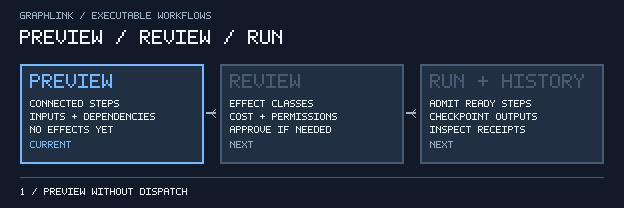
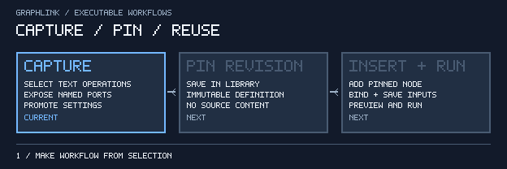
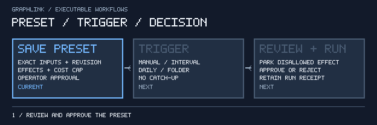

# Executable Workflows

Graphlink can run connected operations, reuse a versioned workflow, and execute a
frozen workflow away from the canvas. Start with a local, pure example; add model
calls or other effects only after reviewing their inputs, permissions and costs.

- [Choose a run surface](#choose-a-run-surface)
- [Reuse a workflow](#reuse-a-workflow)
- [Build a detached workflow](#build-a-detached-workflow)
- [Steps and ports](#steps-and-ports)
- [Side effects, approvals and budgets](#side-effects-approvals-and-budgets)
- [Control flow](#control-flow)
- [Run history and recovery](#run-history-and-recovery)
- [Presets and triggers](#presets-and-triggers)
- [Headless and MCP](#headless-and-mcp)

## Choose a run surface

| Surface | Use it for | Execution and persistence |
| --- | --- | --- |
| **Plugins → Graph Runner** | Connected notes, table/chart/report, local Model, scientific and MCP Connect nodes | Preview the selected branch or whole graph; run against the live scene and checkpoint graph results. |
| **Workflows → Workflow library → Workflows** | Capture connected text operations and reuse them in other graphs | A pinned Workflow node runs a pure child workflow as one Graph Runner step. |
| **Workflow library → Workflows → a workflow → Run it**, or **Runs → Run from JSON** | Typed specifications, service steps, branching, mapping and human gates | Backend-owned workspace run with its own immutable spec, inputs and journal; no live canvas traversal. |
| **Workflow library → Presets** | Repeat an exact approved request, manually or on a trigger | Detached execution under a pinned unattended policy and budget. |

Canvas Graph Runner and the detached engine share adapter infrastructure, but
are not interchangeable. Canvas edges and node journals are not automatically
converted into typed WorkflowSpec files. Scientific and MCP Connect canvas
steps retain their own execution and approval paths; they are not generic
detached adapters.

For a quick canvas run, create a table, a grouped table and chart/report
outputs as in the [README example](../README.md#run-connected-outputs-together).
Edit the original table, open **Plugins → Graph Runner**, select **Whole
graph** or **Selected nodes**, and choose **Preview run**. Inspect what will
run, what is stale, and which inputs must be produced first. Choose **Run
graph** and review any required approvals. The preview does not execute the
model or tool. Reopen the runner or Run history to inspect the results.



*Illustrative animation, not a recording of the application.*

## Reuse a workflow

1. On the canvas, connect plain notes using Copy text or Word count operations.
   Select the connected operations you want to reuse.
2. Open **Workflows** in the app bar, choose **Make from selection**, give
   the workflow a name, choose what it returns, and optionally keep operation
   choices adjustable as settings. External sources become named
   inputs, not embedded source text.
3. Save as a new workflow or append a revision to an existing library entry.
   Open it via **Open / version history** and select the revision.
4. Choose **Add pinned Workflow node**. Fill its text/JSON/table inputs, or
   connect text sources; set any promoted parameters and **Save inputs**.
   A single exposed text output can feed another text-input node.
5. Preview and run it with Graph Runner. Inspect outputs and the linked child
   run ID on the node.



*Illustrative animation; the library and graph remain separate.*

The library is global to the local chats database. Versions are immutable:
renaming changes the label, editing appends a revision, duplicating creates
a separate entry, and deleting archives the entry without invalidating nodes
pinned to it. A new version never silently replaces a pinned version. Use
**Check for newer version** and review the upgrade: it clears the saved
inputs, parameters and outputs. Unpack is available for definitions composed
of the supported native plain-note operations.

**Export version** produces a `.graphlink-workflow` file. Ordinary portable
files contain a v1 spec and parameter declarations, not source canvas IDs,
input contents or run history. Import validates adapter versions, port
compatibility and cycles, rejects secrets and non-pure steps, and creates a
new local identity. The UI accepts files up to 1 MB. Imported pure transforms
and chart/report definitions may run as pinned nodes even when they cannot be
unpacked into editable canvas operations. Do not treat an imported definition
as a grant to execute code or make external requests.

### Built-in starters

Under **Starters** in the Workflows tab, choose **Add to library**. The
workflow opens with a sample filled into its **Run it** form:

| Starter | Example task |
| --- | --- |
| Table to chart to report | Group a ticket table, chart it and produce a report with model commentary. |
| Research to summary | Summarize supplied source-labelled notes. |
| Compare two models on one prompt | Produce two answers and compare them. |
| Document question answering with citations | Answer against supplied passage-labelled text. |
| Summarize every table row | Map a summary over rows, retaining item order. |
| Text quality gate | Rewrite a draft and assert a nonempty Action line. |

The research/document starters use supplied text, not live research or
indexing; model-generated citation labels are not verified references.
The examples use local Ollama at `http://127.0.0.1:11434` with
`qwen3:8b` (and `llama3.2:3b` for comparison). Install the models or edit the
request's model/endpoint configuration, including contained Map specs, before
previewing. Import and export of the exact shipped starter format is supported
separately from the pure-only portable library. A starter does not grant
approval or become a reusable effectful canvas node.

## Build a detached workflow

Open a workflow in the **Workflows** tab and fill its **Run it** form: one
field per input (text, a JSON value, or comma-separated values for a table).
Turn on **Edit as JSON** to change model IDs or supply file inputs. For a
spec you wrote yourself, use **Runs → Run from JSON** and paste a request
into **Workflow request JSON (spec and parameters)**. Choose **Preview
workflow**, review each step's effect, model and estimated cost, then choose
**Approve preview and start** (or **Start reviewed workflow** when no approval
is needed). The run opens in the **Runs** tab.

A version-one spec is an immutable directed acyclic graph (DAG). It declares
a workflow ID and revision, named input/output ports, stable step IDs,
exact adapter IDs and versions, side-effect classes, canonical JSON strings
for step configuration, and explicit bindings. A binding points to a workflow
input or a named step output. The scheduler follows those dependencies, not
the order in the JSON array or the position of canvas nodes. Unknown adapters
or versions, mismatched descriptors, incompatible ports, missing required
inputs, duplicate IDs and cycles fail validation before dispatch.

### First pure request

This example uses only the built-in template adapter; it needs no model,
network, executable or external service. Paste the complete JSON into the
inspector. The declared `greeting` output should contain `Hello Graphlink!`.
Change the parameter and preview again to run with another name.

```json
{
  "spec": {
    "schema_version": 1,
    "workflow_id": "hello-workflow",
    "revision": "v1",
    "name": "Hello workflow",
    "inputs": [
      {
        "name": "name",
        "kind": "text",
        "required": true
      }
    ],
    "steps": [
      {
        "step_id": "greet",
        "adapter": {
          "adapter_id": "transform.template",
          "adapter_version": "1",
          "ports": {
            "inputs": [
              {
                "name": "name",
                "kind": "text",
                "required": true
              }
            ],
            "outputs": [
              {
                "name": "text",
                "kind": "text",
                "required": true
              }
            ]
          },
          "side_effect_class": "pure"
        },
        "config_json": "{\"template\":\"Hello {name}!\"}",
        "bindings": [
          {
            "port": "name",
            "source": {
              "kind": "input",
              "port": "name"
            }
          }
        ]
      }
    ],
    "outputs": [
      {
        "port": {
          "name": "greeting",
          "kind": "text",
          "required": true
        },
        "source": {
          "kind": "step",
          "step_id": "greet",
          "port": "text"
        }
      }
    ]
  },
  "parameters": {
    "name": {
      "kind": "text",
      "text": "Graphlink"
    }
  }
}
```

Here, `config_json` is deliberately a JSON **string**, not a nested object.
The outer `parameters` map holds typed values, distinct from promoted
library settings. Developers should construct the descriptor with
`builtin_registry().describe(adapter_id, "1", freeze_config(config))` to
avoid stale or mismatched ports. See the
[contract implementation](../backend/workflow/contracts.py),
[wire decoder](../backend/workflow/wire.py) and
[developer reference](../backend/workflow/README.md).

## Steps and ports

### Port types

| Kind | Value record (example) |
| --- | --- |
| text | `{"kind":"text","text":"hello"}` |
| JSON | `{"kind":"json","value":{"score":10}}` — any JSON value, including null |
| table | `{"kind":"table","columns":["team","hours"],"rows":[["Design",7]]}` — ordered unique columns, rectangular scalar rows |
| file | `{"kind":"file","asset":{...}}` — immutable binary reference |
| image | `{"kind":"image","asset":{...}}` — immutable image reference |

File/image references pin the asset ID, SHA-256, media type, filename and
size. Use the authenticated file import endpoint for actual bytes; a path or
URL is not an asset reference. Identical types pass unchanged. The only
cross-kind coercions are JSON → text (pretty-printed JSON), table → text
(CSV with header), and table → JSON (row objects). All others fail with a
port-specific reason. No implicit image/file loading or conversion occurs.

### Built-in adapters (v1)

| Pure transform | Input → output | Configuration |
| --- | --- | --- |
| `transform.template` | named text → text | template with simple named fields |
| `transform.json_path` | JSON → JSON | single-value path, e.g. `$.users[0].name` |
| `transform.text_split` | text → JSON string array | literal nonempty separator |
| `transform.text_join` | JSON string array → text | literal separator |
| `transform.table_filter` | table → table | column, operator, value |
| `transform.table_sort` | table → table | column, asc/desc direction |
| `transform.table_select` | table → table | ordered columns |
| `transform.table_rename` | table → table | mapping of old to new names |
| `graph.note` | text → text | copy or word_count |
| `graph.group_sum` | table-compatible text → table/chart JSON/report text | label/value columns and output kind |

Transforms have no external effects. Templates reject arbitrary attribute
access/format expressions; JSON paths do not execute scripts or wildcards;
table operations preserve inputs and reject invalid columns.

| Service adapter | Class | Input → output |
| --- | --- | --- |
| `graph.local_model` | executes | text → text via explicit loopback Ollama |
| `model.generate` | cloud | named text → text or schema-validated JSON |
| `python.execute` | executes | declared typed variables → text, JSON, table or file |
| `knowledge.search` | local-read | query text → passages JSON and cited text |
| `web.research` | cloud | query text → cited text and sources JSON |
| `chart.generate` | pure | table and optional title → chart JSON |
| `report.generate` | pure | table and optional intro → Markdown report |
| `image.generate` | cloud | prompt → image asset |
| `agent.run` | executes | task → text |

The registry describes these adapters; service execution requires a trusted
host with the actual session services and policies. A descriptor alone does
not make an effectful service executable. Model identity and pricing must be
trusted; model JSON is validated against the supported schema subset and
invalid replies fail, not auto-repair. Python uses the existing guarded
virtualenv sandbox, not an OS filesystem isolation boundary; no automatic
dependency installation. Knowledge obeys embedding consent (keyword fallback
when needed), web research retains domain/redirect approval, Fal requires
fresh exact price/prompt/model approval, and Agent requires a trusted folder
and fresh approvals. See [service adapter configuration](../backend/workflow/README.md#typed-service-steps-version-1).

## Side effects, approvals and budgets

| Class | Meaning | Examples |
| --- | --- | --- |
| `pure` | Deterministic local computation with no external effects | template, chart |
| `local-read` | Read local data | knowledge search |
| `cloud` | External service request, potentially paid | model, research, image |
| `executes` | Run code, a process or agent | Python, local model, Agent |
| `writes` | Change external or persistent resources | write-capable adapter class (not a blanket write permission) |

Classes describe behavior, not grants. Preparation, fingerprinting and
preview do not dispatch effects. Review the exact spec/revision, parameters,
provider/model identity, classes and estimated cost before starting. The
manual detached engine requires a fresh approval for cloud, executes and
writes; tokens are expiring, single-use and pinned to the reviewed preview.
Changed pins require another preview. Service-specific grants and approvals
still apply; no token confers arbitrary execution. Cancellation is not
rollback of external changes or charges.

Detached engine defaults (host may configure stricter/different limits):

| Budget | Default |
| --- | --- |
| Cloud concurrency | 4 |
| Local concurrency | 1 (separate semaphore) |
| Maximum run cost | USD 2.00 |
| Duration | 1,800 seconds (30 minutes) |
| Step attempts | 500, including expanded Map attempts |

Cost is reserved before dispatch using trusted policy; a cloud adapter
without trusted policy metadata is rejected. Missing usage is charged at the
reserved maximum; an overrun stops admission rather than reversing an
already-incurred charge. The provider adapter must enforce its own bound;
a token estimate alone is not a spend guarantee. For presets, the effective
cost cap is the lesser of the reviewed cap and host cap.

## Control flow

The detached typed engine supports these v1 adapters. They are not new
conditional/loop canvas node kinds.

| Adapter | Configuration and behavior |
| --- | --- |
| `control.condition` | kind (text/JSON/table; default JSON), predicate and arguments; sends value to exactly one of then/else. |
| `control.assert` | kind, predicate, on_failure=block (default) or route; passes value or blocks/uses fail output. |
| `control.merge` | kind, named inputs, mode=all or first; all returns an ordered JSON array of available values, first returns the first available value of the original kind. |
| `control.approval` | kind (default JSON), message; forwards value only after human approval. |
| `control.map` | contained v1 workflow, concurrency (1–100, default 1), on_error=stop/continue, optional item_count; maps items to input-order results. |

Condition predicates include equals, contains, regex, numeric_compare, empty
and json_path_truthy. Assert supports contains, regex, json_schema,
numeric_range and row_count. Predicates are deterministic, type-aware and
validated; invalid configuration is an error, not a false condition.
json_schema follows JSON Schema numeric semantics: `1.0` is an integer and
equals `1` in `enum`, but `true` never equals `1`.

For example, branch a draft through Condition, send the true branch to a
transform, the false branch to another transform, and bind both to Merge
first. Untaken outputs and dependent steps are recorded as skipped, not
failed. Merge all waits for terminal inputs and emits available values in
declared port order. Merge first uses completion sequence and binding order
for ties (direct parameters are available immediately); it does not cancel
other producers or hide their failures. No available input means skipped
if there was no failure.

A human Approval gate drains already-admitted work, then stops admission.
Choose **Review run** in the notification, or open the run in the **Runs**
tab, and choose **Approve step** or **Reject step**. Reject blocks the run. The
manual run's duration clock pauses during this wait (no automatic approval
or gate timeout); a preset's duration cap includes waiting, including
explicit gates. Backend restart interrupts the run, not silently resumes it.

Map accepts a JSON array or table rows as JSON objects, at most 100 items.
Its child spec must have exactly one required JSON input named `item`.
Nested Maps and human Approval inside Map are not supported. For directly
bound input the preview derives the count; for an upstream output supply
`item_count` and match it at runtime. Child costs/attempts are reserved before
dispatch, children share provider semaphores and have private scratch scenes.
Results are an input-order array of `{index,status,outputs,error,cost_usd}`
records with typed outputs; empty input returns an empty array. Stop mode
cancels in-flight items and admits no more after failure; continue retains
item errors. Budget overruns still stop the run. See the [control-flow
reference](../backend/workflow/README.md#deterministic-control-flow-version-1)
for exact predicate arguments.

## Run history and recovery

**Run history** shows durable receipts for the open graph, with content
hidden by default. Inspect steps, input/output references, attempt status,
timing, events and comparisons. Archived plans retain receipts; full bodies
and re-run controls require a matching live plan. For eligible graph steps,
use **Re-run from this step** or **Run failed steps only**, and review the new
preview. See [Graph Run Inspector](GRAPH_RUN_INSPECTOR.md). Do not retry a
remote request with an uncertain outcome: check the service and explicitly
reconcile the receipt first. Undo changes the local canvas, not the service.

The **Runs** tab is workspace-scoped rather than tied to the open graph.
Open a run to see its result, each step's status, outputs and errors, skipped
branches, pending approvals, Map progress, the reviewed preview and the event
log. **Save result as graph** copies a completed run into the chat library.
The run ID is returned before execution. Cancel prevents further admission
and requests cancellation of active work; completed results survive. Restart
marks unfinished runs interrupted and does not replay uncertain external
effects. Start a new, reviewed run only after checking outstanding effects.

The detached journal retains the newest 50 runs per workspace for up to 90
days (active runs exempt until terminal). Values above 64 KiB may be stored
as content references; files/images are content-addressed. The authorized
`save-as-graph` API can create a new graph from retained outputs (or completed
intermediates if no declared output finished), without replacing the current
graph. Asset collection is offline and reference-aware; see
[asset maintenance](ASSET_MAINTENANCE.md). Retention is not secure erasure or
a guarantee of remote exactly-once execution.

## Presets and triggers

Open **Workflow library → Presets** and choose **New preset** (or **More →
Save as a preset…** on a workflow's page):

1. Choose the workflow, name the preset and fill its inputs. Settings you
   leave empty keep the version's saved values. Presets accept text, JSON and
   table inputs.
2. Under **What it may do without you**, tick the effects that may run
   unattended and set the **Cost cap per run**. Start with pure only and
   $0 for the template example.
3. Under **When it runs**, choose **When I run it**, **On an interval**,
   **Daily** or **When a folder changes**, then **Preview preset**, review
   each step and **Approve and save preset**.
4. Choose **Run now** for an immediate run, or leave Graphlink running
   for the trigger. Its runs appear in the **Runs** tab.



*Illustrative animation; unattended execution is constrained by the reviewed policy.*

| Trigger | Behavior |
| --- | --- |
| Manual / CLI / MCP only | Starts only on explicit request. |
| Interval | At least 10 seconds between scheduled triggers. |
| Daily (local time) | Local HH:MM schedule. |
| Watched folder | Existing directory, recursive metadata changes, no symlink traversal, at most 10,000 entries. No file contents are read by the watcher. |

The scheduler runs only during the backend's lifespan, not as an external
cron/service. It establishes a fresh baseline after startup or creation;
missed intervals and triggers while the workflow is busy are skipped, not
queued or replayed. Folder changes do not import files or override parameters.
Only one detached run per workflow ID can be active, including across pinned
revisions and paused runs. Deleting a preset stops future triggers but does
not cancel an admitted run.

The preset pins its exact request, revision, resolved preview fingerprint,
allowed effects and maximum cost. Admission re-resolves and compares pins;
changed parameters, policies or unavailable definitions require a new review.
Only pure, local-read and cloud may be selected for unattended dispatch.
A cloud execution lane also requires cloud permission. Disallowed effects,
including every executes/writes step, park before dispatch for a fresh
operator decision. Review the pending step and frozen inputs in the library,
then approve or reject the specific nonce-bound request. Denial stops the
run. A preset Map requires all child effects and execution lanes to be
allowed; per-item approval is unsupported. Use a manual run for Maps that
need fresh child approvals.

## Headless and MCP

Start the same backend with an authenticated operator UI and separate write
credential, from a checkout with requirements and the SPA built:

```sh
python -m backend.headless --port 8765 --allow-mcp-writes --open-ui
```

Use the local browser to approve a preset and any pending decisions. Only
one backend can own the data directory. Read-only MCP is the default;
neither the read nor scoped write token can create or approve presets,
approve steps, execute arbitrary specs or access administrative APIs.

The CLI connects to the running backend rather than opening a second database.
Use the actual workspace/preset/run IDs and token paths; the read token file
defaults to `~/.graphlink/headless.token`. Example:

```sh
python -m backend.workflow.cli --url http://127.0.0.1:8765 --write-token-file ~/.graphlink/headless.write.token --workspace-id 1 list
python -m backend.workflow.cli --url http://127.0.0.1:8765 --write-token-file ~/.graphlink/headless.write.token --workspace-id 1 run PRESET_ID --operation-id example-run-01
python -m backend.workflow.cli --url http://127.0.0.1:8765 --write-token-file ~/.graphlink/headless.write.token --workspace-id 1 read RUN_ID
```

`run` optionally accepts `--request-json` to verify the **exact** approved
request, not override inputs. Reuse the printed operation ID with the
original request to recover a lost response while the receipt is retained;
do not generate a new ID for an uncertain start. An intentional new run
requires a new operation ID. A conflict or changed fingerprint calls for
operator review.

Start the stdio MCP adapter with the opt-in write credential:

```sh
python -m backend.mcp_server --url http://127.0.0.1:8765 --write-token-file ~/.graphlink/headless.write.token
```

| MCP tool (write-token opt-in) | Arguments |
| --- | --- |
| `graphlink_list_workflows` | workspace_id; lists library entries and approved presets |
| `graphlink_run_workflow` | workspace_id, preset_id, operation_id; optional request_json string (exact approved request) |
| `graphlink_get_workflow_run` | workspace_id, run_id; reads retained preset-run status, steps, outputs and awaiting_approval |

Both list and get require the separate write credential even though read-only.
Read is scoped to preset runs; it is not general run history. Results are
untrusted data, not instructions or permission grants. If a step waits,
return to the authenticated Graphlink operator UI. There is no MCP approval,
preset creation, arbitrary-spec run or workflow cancellation tool. See
[Headless Graphlink and MCP](HEADLESS_MCP.md) for credentials and setup, and
[MCP Connect](MCP_CONNECT.md) for the opposite direction (Graphlink calling
external tools from the canvas).

### Builder and developer entry points

Builder can discover workflow IDs with `workflow.list`, produce an exact
review with `workflow.preview_edit`, and request fresh approval for
`workflow.instantiate`, `workflow.wire_inputs`, `workflow.create_step` and
`workflow.create_control`. Even Autopilot must get fresh approval and recheck
the preview after approval. These are undoable canvas edits, not run
admission. Step creation is limited to bound text copy/word-count notes;
control creation is limited to literal input and bound output boundaries.
Execute via the ordinary Graph Runner review.

For trusted application developers, [backend/workflow/README.md](../backend/workflow/README.md)
documents the Python service and complete adapter configurations. The
authenticated application API prefix is `/api/workflows/{workspace_id}`:
POST preview/approve/runs, GET runs and runs/{run_id}, POST cancel,
step-approval (human gate), step-decision (nonce-bound preset effect),
save-as-graph, files, preset preview/save/run, GET presets and DELETE a
preset. These routes use the full app capability, not MCP credentials.
The [repository navigation index](../GRAPHLINK_REPO_NAVIGATION.md) maps
implementation and regression tests.
